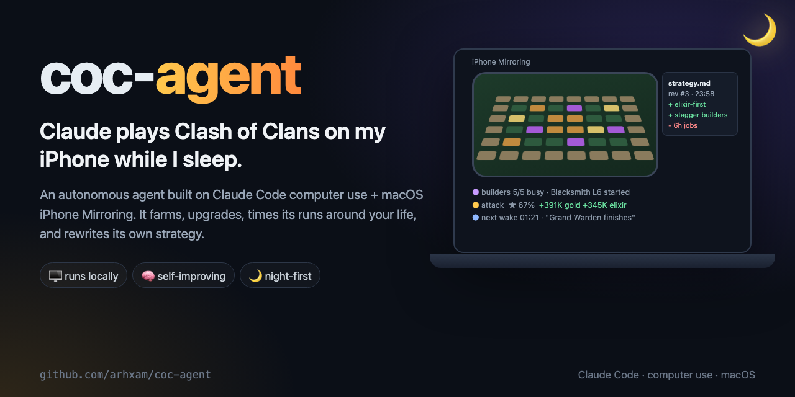
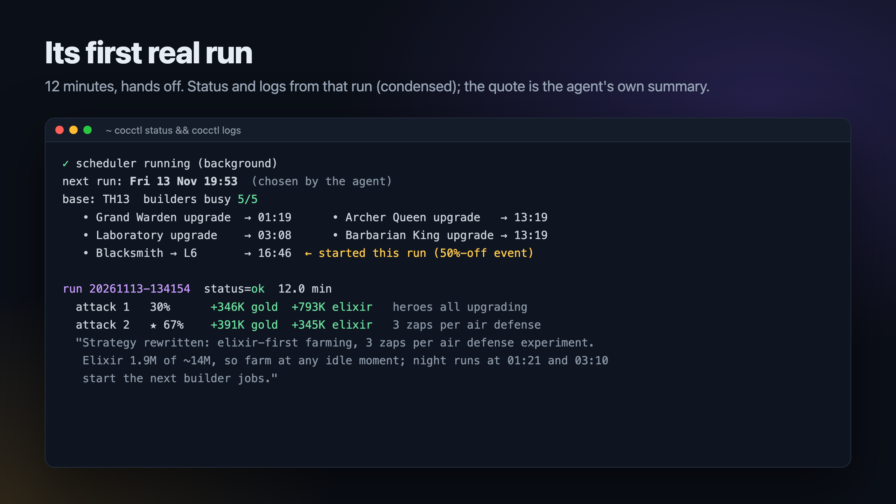
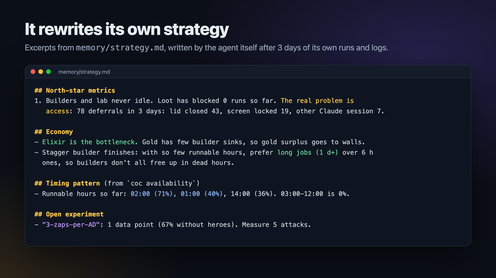
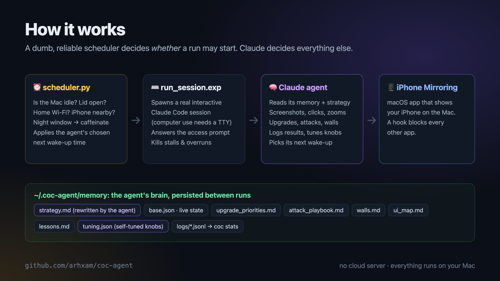

<p align="center">
  
</p>

<p align="center">
  <b>An autonomous Clash of Clans agent built on Claude Code computer use and macOS iPhone Mirroring.</b><br>
  It farms loot, keeps every builder busy, upgrades walls from surplus, runs at night or when you're away,<br>
  and rewrites its own strategy as it learns.
</p>

<p align="center">
  
  
  
  
  
</p>

---

## What it does

There's no game API, no memory reading and no injected code. Claude **looks at the screen and taps**, the way you would, through the iPhone Mirroring window on your Mac.

- **Banks loot.** It keeps storages near full so the moment a builder or the lab frees up, the next upgrade starts. Its #1 metric is *"a builder never waits for loot."*
- **Walls as an overflow valve.** It upgrades walls only with surplus above a reserve, a few per day.
- **Schedules around your life.** It does most of its work in a night window, and during the day only when you're home, the Mac is idle and the phone is locked nearby. **Claude picks its own next wake-up time** ("Builder 2 frees at 03:10, wake then").
- **Learns.** It keeps a persistent memory, logs every attack and upgrade, tunes its own knobs (loot thresholds, attacks per run) from its stats, runs one experiment at a time, and rewrites `strategy.md` in a daily review.

<p align="center"></p>

<p align="center"></p>

## How it works

<p align="center"></p>

Two layers with a strict split:

1. **`scheduler.py`**: a small, reliable daemon. It decides only *whether a run may start now*: Mac idle, lid open, screen unlocked, on home Wi-Fi, iPhone nearby over Bluetooth, battery OK, no other Claude session holding computer use.
2. **The Claude agent** decides everything about the game, including when it should run next.

Computer use only works in an **interactive** Claude Code session (not `claude -p`), so `run_session.exp` drives the real TUI in a pseudo-terminal with `expect`. It answers the app-access prompt, nudges or kills stalled runs, and closes the session when the agent calls `coc finish`.

The full design doc, with the timing logic, safety rails and every config knob, is in [`docs/overview.html`](docs/overview.html) (or run `cocctl overview`).

## Requirements

- A Mac with **macOS 15 (Sequoia) or later** and **iPhone Mirroring** set up with your iPhone (iOS 18+)
- **[Claude Code](https://docs.anthropic.com/en/docs/claude-code)** with **computer use** available on your plan
- `python3` and `expect` (both ship with macOS). No pip packages.
- Clash of Clans installed on the iPhone and logged in

## Quick start

```bash
git clone https://github.com/arhxam/coc-agent.git
cd coc-agent
./bin/cocctl install          # installs to ~/.coc-agent and links `cocctl` into ~/.local/bin
```

Make sure `~/.local/bin` is on your `PATH`, then:

```bash
cocctl doctor                 # check prerequisites, permissions and the computer-use lock
cocctl run-now --attach       # first supervised run: watch it play (hands off the mouse)
cocctl start                  # run the background scheduler      (cocctl stop to stop)
cocctl autostart on           # optional: start at login via launchd
```

**One-time setup notes**

- Run `install` while you're on your **home Wi-Fi**. It records your router as "home" and finds your iPhone over Bluetooth. Add another network later with `cocctl home-here`.
- macOS will ask for **Screen Recording** and **Accessibility** for the app that launches Claude (your terminal, or `python3` with autostart). Grant both.
- Close any other Claude Code session that used computer use first. Only one session can hold it at a time, and `doctor` tells you who has it.
- Lock your iPhone and leave it near the Mac. The agent backs off if you're using the phone.
- **Adjust the seed memory to your base.** `app/memory_seed/` ships with my Town Hall 13 Electro Dragon setup as an example. The agent verifies and rewrites it on the first runs, but editing `attack_playbook.md` and `upgrade_priorities.md` to match your army gets you there faster. Then run `./bin/cocctl install --reseed-memory`.

## Everyday commands

| command | what it shows / does |
|---|---|
| `cocctl status` | next run and why, builder timers, recent runs |
| `cocctl logs -f` | live scheduler log |
| `cocctl transcript` | what the agent saw and did in the last run |
| `cocctl strategy` | the agent's current living strategy |
| `cocctl stats` | loot per attack, walls per day, "builder waited for loot" count |
| `cocctl availability` | which hours of the day runs actually work |
| `cocctl presence` | home network, iPhone nearby, idle, night |
| `cocctl pause` / `resume` | stop starting new runs without stopping the daemon |
| `cocctl next "+20m"` | override the next run time |
| `cocctl uninstall` | stop the scheduler and remove autostart (keeps `~/.coc-agent`; delete it for a clean slate) |

Config lives in `~/.coc-agent/config.json`. The useful knobs are the night window (`night_hours`), `max_run_minutes`, `model` (a cheaper model uses less of your plan), and `game_limits` (hard caps the agent can't tune past).

## Safety rails

**Enforced by code**
- A `PreToolUse` hook allows computer use for **iPhone Mirroring only**. Every other Mac app is blocked.
- The agent runs with `--permission-mode dontAsk` and an allow-list: read anything, edit only `memory/**`, run only `./bin/coc`. No web access.
- Hard time cap per run, stall detection, one run at a time, a daily run cap.

**Enforced by instructions** ([`app/CLAUDE.md`](app/CLAUDE.md))
- No real money, ever. No gems unless you turn on `game_limits.use_gems`.
- It never touches settings, your account, your clan or chat, and never removes or sells anything.

## Repo layout

| path | role |
|---|---|
| `bin/cocctl` | control CLI |
| `app/scheduler.py` | daemon: preflight checks, presence sensing, launches runs, applies the agent's next wake-up |
| `app/run_session.exp` | drives one interactive Claude Code session |
| `app/CLAUDE.md` | the agent's run protocol and hard rules |
| `app/tools/coc.py` | the `coc` helper the agent uses for time math, logging, stats, tuning and `finish` |
| `app/hooks/guard_apps.py` | hook that restricts computer use to iPhone Mirroring |
| `app/memory_seed/` | starting memory: `strategy.md`, playbook, priorities, walls, UI quirks |
| `app/config.default.json` | defaults (override in `~/.coc-agent/config.json`) |
| `docs/` | design overview and images (image sources in `docs/images/src/`) |

## Limits and risks

- ⚠️ **Automating Clash of Clans is against Supercell's Terms of Service.** Your account can be banned. Use it on an account you're willing to lose. This is an experiment in agentic computer use, not a cheat tool.
- It's slow and uses a lot of tokens: each run is many screenshots. On a Claude subscription that's plan usage. Lower it with fewer attacks per run, a cheaper `model`, or a longer `min_interval_minutes`.
- It only runs when the Mac is awake and unlocked, the lid is open, and the phone is reachable. In practice access, not loot, turned out to be the bottleneck (the agent worked this out itself, see the strategy screenshot above).
- Screen coordinates and game UI change between versions. The agent records quirks in `ui_map.md` and adapts, but expect occasional `needs_human` runs.

## Disclaimer

Not affiliated with, endorsed, sponsored, or approved by Supercell. Clash of Clans is a trademark of Supercell Oy. Not affiliated with Anthropic or Apple.

## License

[MIT](LICENSE)
